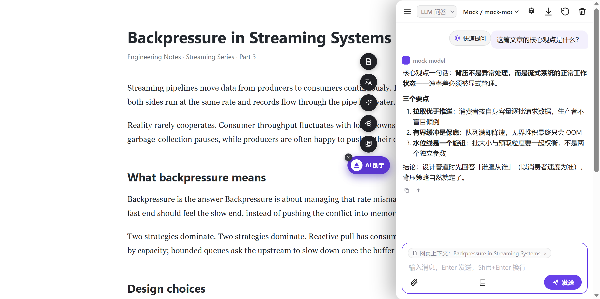
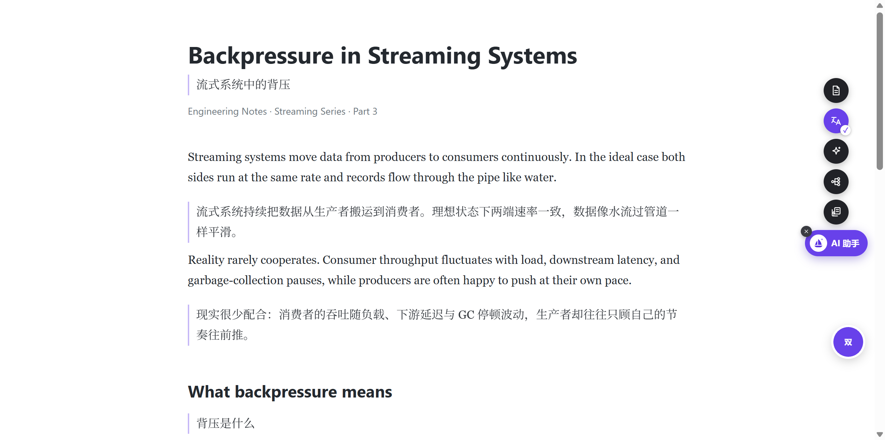
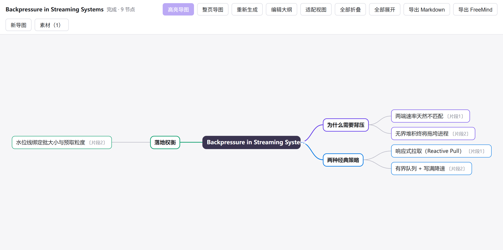
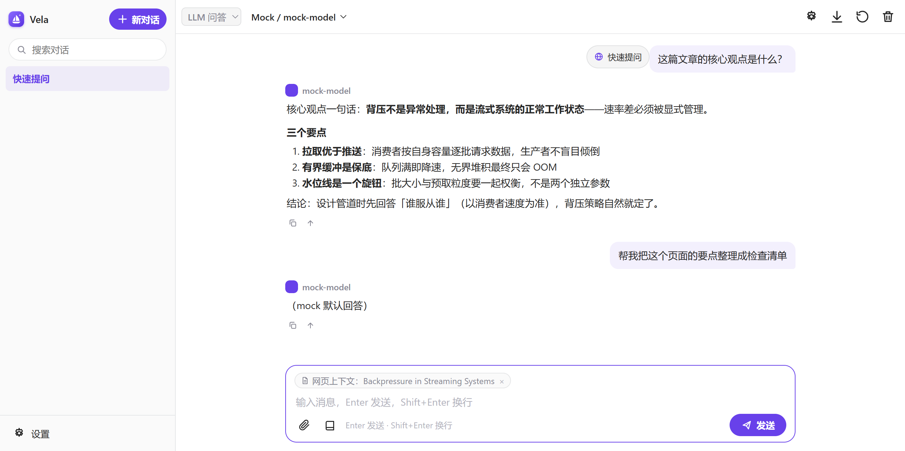

# Vela

[简体中文](README.zh-CN.md) | **English**

A self-built Chrome AI assistant extension (MV3). Zero build step, zero third-party dependencies: plain ES modules loaded directly by Chrome. Bring your own LLM provider (any OpenAI-compatible or Anthropic-compatible Base URL + API Key), or use the local Agent engine that drives your machine's Claude Code / Codex CLIs through a companion bridge process (reusing their logins — no extra API key). All data stays local: no server, no telemetry, no account.

## Preview

| In-page chat card · follow-ups with page context | Full-page translation · bilingual |
|---|---|
|  |  |
| Selection mind map · from highlights | Agent engine · thinking & tool steps |
|  |  |

## Why Vela

Unlike account-based assistants metered by per-day quotas, Vela leaves both control and cost with you:

- **Your data never leaves the machine** — no accounts, no telemetry, no server. Conversations and settings live in local browser storage; network requests go only to your configured provider endpoints and the local bridge
- **Reuses your local CLI logins** — the Agent engine drives your already-logged-in Claude Code / Codex through a local bridge: no extra API key to buy, it runs on your existing subscription
- **BYO key, no quotas** — any OpenAI / Anthropic compatible endpoint works out of the box; no "N requests per day" caps, costs go straight to your own key
- **Lightweight footprint** — the only always-on injections are the floating widget and the selection toolbar (~100KB of uncompressed source); extraction, translation backfill and other heavy scripts load on demand, so everyday browsing stays fast
- **Long answers never cut off** — all streaming runs in extension pages, sidestepping the MV3 30-second service-worker eviction, so long summaries and full-page translations aren't interrupted mid-stream
- **Auditable source** — zero build step, zero dependencies, plain ES modules loaded as-is: what you install is code you can read

## Feature Overview

| Capability | Description |
|---|---|
| Three chat surfaces | Native side panel (`Ctrl+M`), standalone chat page (`Ctrl+Shift+M`), and an in-page chat card (toggled from the floating widget, follows the host page context) |
| Three engines | **Agent** (local CLI, default) · **LLM Chat** (direct provider streaming) · **LLM Tasks** (model-driven tool loop) |
| Page summary | Extracts the article and streams a summary; ask follow-ups |
| Full-page translation | Viewport-driven, bilingual / immersive modes, translates as you scroll; bubble menu to switch mode or restore |
| Selection actions | Selection toolbar + context-menu group (translate / explain / summarize / rewrite — templates editable) |
| Selection mind maps | Batch-generate from highlights or from the full-page article (dual mode); export Markdown / FreeMind |
| Media understanding | Hover any image / video for a popup panel: analyze, extract text, feed into mind map, download, video keyframe analysis |
| Continuous reading | Auto-follows "next page" links from the current article, per-page summaries plus a final digest |
| Knowledge base | Per-conversation access to local folders / files (three sources: zero-copy handles / read-only snapshots / bridge paths), shared by all engines |

## Installation

1. Open `chrome://extensions` and enable **Developer mode** (top right)
2. Click **Load unpacked** → select this repository root (or extract `dist/vela-<version>.zip` and select the extracted folder)
3. After upgrading or editing code: click **Reload** on the extensions page (registered content scripts like the floating widget only pick up changes after a reload)

## Configure a Provider (required for LLM engines; not for Agent)

1. Open the settings page from the ⚙ in the chat header
2. Add a provider, choose the protocol, fill in Base URL and Key:

| Provider | Protocol | Base URL |
|---|---|---|
| OpenAI | OpenAI-compatible | `https://api.openai.com/v1` |
| Anthropic | Anthropic | `https://api.anthropic.com` |
| Ollama (local) | OpenAI-compatible | `http://localhost:11434/v1` |
| OpenRouter & relays | OpenAI-compatible | See their docs for the version root |
| Zhipu / DeepSeek / Kimi etc. | OpenAI-compatible | See each provider's docs |

3. Type model IDs manually, or click **Test connection** to fetch and merge them (`GET /models`)
4. Check **Default** → **Save all**

## Three Engines

The engine is a per-conversation property, switched from the header (your choice becomes the default for new conversations); switching on a conversation that already has messages starts a new conversation.

- **Agent (default for new conversations)**: drives local Claude Code (Agent SDK) or Codex (`codex app-server`) through the bridge. Prerequisites: bridge running + the CLI installed and logged in on this machine. Streaming text + thinking, tool-call step cards (expandable inputs/results with timing), permission approval cards, cost stats, sub-agent grouping.
- **LLM Chat**: direct SSE streaming chat with your provider; conversations remember the exact "provider / model" routing. Image attachments get vision understanding (OpenAI `image_url` / Anthropic `image` blocks).
- **LLM Tasks**: a model-driven tool loop — 7 browser tools (read current page / selection / tabs, fetch URL, open tab, download) + knowledge-base file tools (list / search / read / write / edit / load_skill). Fetch / open / download require an approval card first, file writes require a diff approval; the step limit (default 12) pauses the run automatically — reply "continue" to resume.

## Chat

- The three surfaces share one codebase (variant-switched); conversation history is shared and auto-synced across views
- Conversation sidebar: filter, switch, hover-rename and delete, sorted by recent activity; streaming output can be stopped midway or regenerated
- Send while running: messages sent during an agent turn are queued (persisted first, survive page close) and delivered one by one when the turn ends; scrolling up during streaming shows a "latest" button to jump back down
- Summary export: export the current conversation as Markdown — the Agent engine writes via bridge into the workspace `docs/` (any local directory works); LLM engines pop a system save dialog; file name `YYYYMMDD-HHmm_topic.md`
- Markdown rendering (code blocks / lists / quotes / links / tables, escape-then-transform to prevent injection)

## Local Agent Engine Details

- **Bridge companion process** (`bridge/`, Node ≥18): a WebSocket bridge between extension pages and local agent CLIs, bound to `127.0.0.1` only; token auto-paired on first handshake + Origin validation (web pages cannot connect)
- **Sub-agents**: steps of sub-agents spawned by the agent (Task tool) collapse under their Task step; for large codebase exploration, bind the project directory as the workspace (knowledge-base popup)
- **Permission mode (per conversation)**: dropdown under the input box — approve each step / auto-accept edits / auto-allow; global default configurable in settings
- **Model (per conversation)**: dropdown under the input box; options are fetched live from the LLM gateway behind the agent via the bridge, with Claude falling back to Opus / Sonnet / Haiku aliases when unavailable; the default entry shows the actual resolved model
- **Conversation workspace**: each conversation gets its own subdirectory under the "workspace base directory" (default `~/.vela-bridge/workspaces`); you can also bind a local project directory as the workspace (the agent works directly inside the project)
- **Knowledge base & attachments**: see below; attachments support files, images, audio/video (≤100MB each and cumulative), uploaded into the workspace `uploads/` on send
- Agent-side sessions resume across turns: automatic frame backfill on reconnect (500-frame buffer), context survives bridge restarts

## Knowledge Base (per conversation, one entry point for all engines)

Book-shaped button above the input box, badge shows the entry count. Four sources:

| Source | Where | Behavior |
|---|---|---|
| Pick a local directory (handle) | Side panel / chat page / settings | File System Access zero-copy reference; files are read on demand — usable by Agent and LLM Tasks |
| Authorize folder / file (snapshot) | In-page chat card | Cross-origin iframes cannot open the system picker, so it degrades automatically: bytes are copied into the extension's IndexedDB as a read-only snapshot (limits: 200 files / 50MB each / 200MB total), survives reloads |
| Local absolute path (bridge path) | Machines with bridge | LLM Tasks read/write local paths directly, zero-copy |
| Upload into workspace | Agent engine | Incremental sync into the conversation workspace `knowledge/` |

Format support: text with line numbers (GBK fallback when UTF-8 fails), docx / xlsx / pptx converted to Markdown, PDF / images passed to the model as native tool-result attachments. Documentation-style skills live at `.vela/skills/<name>/SKILL.md` inside a knowledge directory.

## Page Features (floating widget / selection toolbar / context menu)

- **Floating widget** (main entry): pinned on the right edge of http(s) pages — dark round action buttons (summarize / translate / explain selection / continuous read / mind map) plus the brand-purple capsule. The capsule toggles the **in-page chat card** in place; "×" hides the widget for the current page (restored on reload); the translate button is a toggle (starts translation in place without opening the chat card, shows ✓ when done, click again to restore); hovering reveals a small settings gear (translation model / target language / bilingual / immersive, saved immediately)
- **Summarize this page**: extracts the current tab's article (title + URL recorded with the message), streams a summary, follow-ups supported
- **Translate this page**: viewport-driven full-page translation — translates the current viewport first (1 screen of prefetch below), continues as you scroll, waiting paragraphs show an inline "translating" marker; bilingual (default) / immersive switchable; code blocks and form controls are skipped automatically, pure identifiers / config tokens / URLs are left untranslated; per-page limits adjustable in settings (default 1500 blocks / 300000 chars)
- **Quick actions**: select text → toolbar or context-menu group; templates editable in settings (`{text}` placeholder)
- **Selection mind maps**: highlights only record, generation is always explicit — "Highlight" collects selected text into a material inbox, the "Mind map" button generates explicitly (highlight-material / full-page dual mode; reopening an unchanged page costs zero LLM calls); supports inline rename, outline round-trip editing, collapse / pan / zoom, export to .md / FreeMind .mm
- **Media understanding**: hover an image / video ≥80px for 200ms and a brand-purple round button appears at its top right; click to open the single-media popup in place. Four actions for images: analyze / extract text / feed into mind map / download; videos get keyframe-based visual analysis
- **Continuous reading**: auto-follows "next page" links from the current article (deterministic scoring, no LLM spent on navigation: `rel=next` > exact text > prefix > bare arrows), **same-origin only**, loop-safe, 30-page limit, 800ms politeness delay between pages; per-page summaries stream into one answer plus a final digest; stop anytime — the page list and stop reason are recorded in the message

## Start the Agent Bridge (optional)

Skip this section if you only use the LLM engines. To use the Agent engine:

```cmd
cd /d <repo path>\bridge
npm install        # first time only
node index.js      # listens on ws://127.0.0.1:39217 by default
```

Or just double-click `bridge\start.bat` (switches directory, installs dependencies on first run, starts). Prefer not to clone the repo? Download `vela-bridge-<version>.zip` from a [GitHub Release](https://github.com/kaizencao/vela/releases), then run `npm install` and `node index.js` the same way. Prerequisites: Claude Code (`claude` command available) or Codex (`codex` command available), installed and logged in on this machine.

**Autostart on boot** (one-time setup; admin rights not required — an HKCU Run key is enough):

```cmd
reg add "HKCU\Software\Microsoft\Windows\CurrentVersion\Run" /v VelaBridge /t REG_SZ /d "wscript.exe \"<repo path>\bridge\bridge-hidden.vbs\"" /f
```

`bridge-hidden.vbs` starts the bridge with no console window; output goes to `bridge\bridge-autostart.log`. To remove autostart: `reg delete "HKCU\Software\Microsoft\Windows\CurrentVersion\Run" /v VelaBridge /f`.

**Start/stop from the settings page**: on first run the bridge registers a `vela-bridge://` URL protocol on Windows; the settings page "Start bridge" button launches it via that protocol, "Stop bridge" shuts it down gracefully, with live connection status. The first launch writes a pairing token to `~/.vela-bridge/token.json` (0600); the extension pairs automatically on first handshake — no manual pasting.

## Repository Layout

```
manifest.json                 MV3 manifest (storage/sidePanel/contextMenus/scripting/downloads + <all_urls>, Chrome ≥116)
bridge/                       local agent bridge companion (Node ≥18, ws + Claude Agent SDK, not in the extension zip)
  server.js / workspace.js    WS server (token pairing, Origin check); workspace resolution + chunked upload state machine
  turn.js                     session hub: seq, 500-frame buffer, permission requests / replies
  agents/claude.js            Claude Code adapter (Agent SDK message stream → normalized events)
  agents/codex.js             Codex adapter (codex app-server JSON-RPC → same event vocabulary)
src/background/               service worker: context menus, pendingTask relay, shortcuts (no network requests)
src/agent/                    extension-side agent client (WS singleton, reconnect backfill, chunked upload), render pure functions, prompt composition
src/llm/                      LLM engine: streamChat, openai/anthropic SSE adapters, sse framing,
                              tool-loop, browser-tools, knowledge-base fs-tools, prompt pure functions
src/kb/                       knowledge base: handle / snapshot storage (IndexedDB), format readers
                              (text/docx/xlsx/pptx/PDF/images), bridge-path virtual handles, agent sync upload
src/read/series.js            continuous reading: next-link scoring / fetching / parsing
src/mindmap/                  selection mind maps (material inbox, outline parse/export, viewer page)
src/media/                    hover media-understanding popup
src/common/html.js            shared fetched-HTML parsing (strips inline event handlers at string level to avoid CSP violation noise)
src/page/                     page feature orchestration (summary / translation / read-series scheduling), hidden translation runner, selection panel
src/content/                  pinned widget, selection toolbar, translation backfill + bubble + SPA guard, article extraction injection
src/ui/                       side panel and chat page share one view (shell / chat-ui / markdown / styles)
src/sidepanel/ src/chatpage/ src/options/    the three page documents
scripts/                      tests (unit + browser e2e), packaging, icon generation
docs/DESIGN.md                extension architecture and protocol design
docs/agent-bridge.md          bridge WS protocol and event vocabulary
docs/cws-publishing.md        Chrome Web Store publishing notes (maintainers, Chinese)
```

## Security Notes

- API keys are stored in plaintext in `chrome.storage.local` (readable only on this machine). Acceptable for personal use; on shared machines, remove provider configs when done
- Conversation history is likewise stored locally in plaintext; deleting a conversation removes it from storage
- No telemetry of any kind; network requests go only to configured provider endpoints
- The agent bridge listens on `127.0.0.1` only and validates the `chrome-extension://` Origin before accepting connections (web pages cannot connect); the token lives at `~/.vela-bridge/token.json` (0600) and is issued automatically to extensions that pass the Origin check. The token defends against web pages — a local malicious process could read the file directly anyway. The bridge can do anything your CLI login can; do not forward the port to the internet
- `host_permissions: ["<all_urls>"]`: summarize/translate target arbitrary pages and the widget is pinned everywhere; per-site opt-in would silently fail on every new site. Page data is only used to build the current prompt — not persisted (except as summary message records), not uploaded (except to provider endpoints)

## Known Limitations

- Markdown rendering does not include images
- Conversation switching is locked during streaming (to prevent interleaved writes)
- `max_tokens` is not sent by default; required by the Anthropic protocol, default 4096. Some newer models reject temperature — leave it blank to omit
- Widget-initiated translations run in a hidden in-page runner iframe and end on page navigation; context-menu-initiated translations run in the side panel / chat page and end when it closes
- The native side panel has no close API (Chrome limitation): in-page open/close is handled by the widget's chat card
- Immersive mode replaces each block with plain translated text; inline links / code markup are restored from snapshots on revert or when switching back to bilingual; code blocks are never translated in either mode
- Continuous reading only follows same-origin "next page" links, never crosses sites; 30-page limit per run (`llmSettings.readSeries.maxPages`)
- Knowledge-base authorization inside the chat card is a read-only snapshot (a browser restriction on cross-origin iframes); for zero-copy handles, authorize from the side panel / chat page
- Overlong contexts are auto-split in half and retried; 429 rate limits abort the round — retry later

## License

[AGPL-3.0](LICENSE) — derivatives that are distributed must be released under the same license. Copyright is held by a single author; separate commercial licensing may be offered on top in the future.
