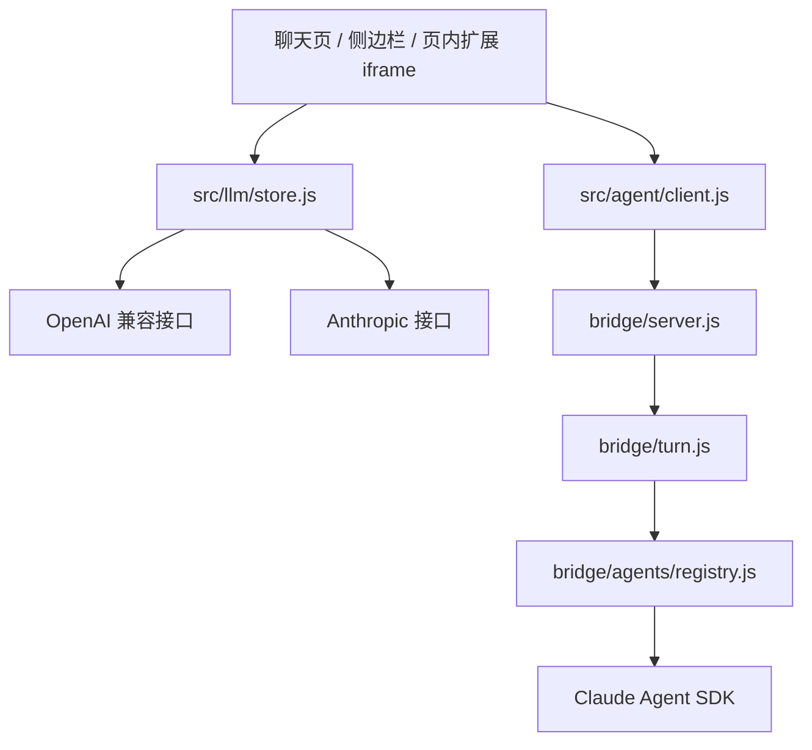
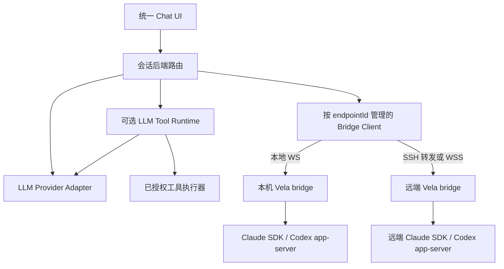
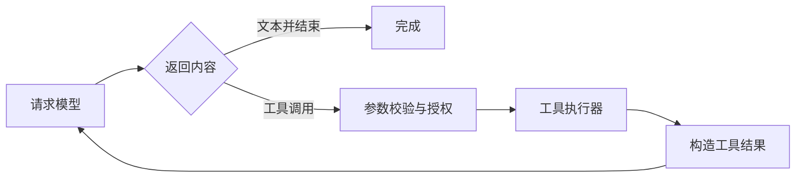

# Vela Chat 多执行后端扩展方案

日期：2026-10-30。状态：调研与设计建议，尚未修改业务代码。

## 1. 结论与范围

三个方向均可实现，而且可以延续现有架构，无需把 Vela 改造成桌面 IDE：

| 用户目标 | 当前基础 | 建议实现 | 工作量判断 |
| --- | --- | --- | --- |
| 直接调用配置的 LLM 问答 | 已有供应商、流式请求、多轮聊天和页面上下文；新聊天入口固定成 Agent | 恢复会话级后端选择，修复供应商与模型的路由 | 较小 |
| LLM 自主完成带工具的任务 | 已有工具展示、浏览器能力和部分文件操作，但没有通用 LLM 工具循环 | 新增工具协议、调度循环和执行权限；分批开放工具 | 中到大，取决于工具范围 |
| 本地 Codex Agent | bridge 已有适配器注册、会话、审批和事件归一化 | 增加 `codex app-server` 适配器 | 中等 |
| 远程 Claude Code / Codex | 已经通过 WebSocket 连接 bridge，天然可分离 UI 与执行端 | 在目标机器运行同一 bridge；新增多端点、鉴权隔离、恢复与文件归属 | 中到大，可靠性工作占主要部分 |

**推荐架构：统一聊天 UI + LLM 直连链路 + 可连接多台机器的 Agent bridge。** 执行方式与执行位置分开建模，不增加 `engine: remote`。远程机器上有 Claude Code/Codex，并运行 Vela bridge，本机只需浏览器；若使用 SSH 隧道，本机还需要 SSH 客户端，但不需要安装 Agent 或 Node。

“任务处理”必须区分两类：总结、改写、推理、生成代码等文本任务可以直接复用 LLM；自动读写文件、运行命令、操作网页需要工具执行循环或完整 Agent。恢复 LLM 入口并不等于获得完整 coding agent。

## 2. 当前项目能复用什么，缺少什么

### 2.1 实际调用链



Vela 是 Chrome MV3 扩展，扩展端使用原生 ES modules；Node bridge 独立分发。流式请求与 WebSocket 位于扩展页面，Service Worker 主要负责路由。应保留这个边界，避免把长期执行任务直接搬进容易被回收的 Service Worker。

| 代码证据 | 现状与影响 |
| --- | --- |
| [`chat-ui.js:90–104`](../src/ui/chat-ui.js#L90) | `currentEngine()` 仍支持 `llm/agent`，但 `newConv()` 写死 `agent`，缺少新会话选择入口 |
| [`chat-ui.js:902`](../src/ui/chat-ui.js#L902) | `runAssistantTurn()` 已支持流式输出、多轮历史、网页上下文和停止，可复用 |
| [`chat-ui.js:442–475`](../src/ui/chat-ui.js#L442) 与 [`store.js:89`](../src/llm/store.js#L89) | 模型选项保存 `[providerId, model]`，发送时只取 model；`streamChat()` 又使用全局供应商。必须同时修复，否则可能选中 A 的模型却请求 B |
| [`openai.js`](../src/llm/openai.js)、[`anthropic.js`](../src/llm/anthropic.js) | 现有流主要面向文本，没有完整的 `tool_calls/tool_use` 解析和工具循环 |
| [`registry.js:1–13`](../bridge/agents/registry.js#L1) | 接口已预留多 Agent，但仅注册 Claude；Codex 尚未实现 |
| [`claude.js`](../bridge/agents/claude.js) 与 [`render.js`](../src/agent/render.js) | 已有启动/恢复、取消、审批，以及文本、思考、工具、计划和用量的统一事件展示 |
| [`client.js:12`](../src/agent/client.js#L12)、[`store.js:20`](../src/llm/store.js#L20) | 每个页面只有一个客户端单例、设置只有一个 `agentBridge`，不支持会话固定不同机器 |
| [`chat-ui.js:1181–1201`](../src/ui/chat-ui.js#L1181) | 恢复只检查 Agent 类型和 SDK session ID，未校验 endpoint 或账号配置；增加远程后可能串机器 |
| [`turn.js:8–49`](../bridge/turn.js#L8) | 会话在内存中，只有最近 500 帧缓存，重放不报告缺口；不能承诺长期断线或进程重启后完整恢复 |
| [`chat-ui.js:416`](../src/ui/chat-ui.js#L416) | 删除会话按当前全局 bridge 清理工作区；多机器后必须改成资源所属端点 |

现有设计文档已经规划过 Codex 与通用适配器。这次应沿该扩展点实现，但以当前代码为准，不能把设计文档中的未来能力当成现成功能。

### 2.2 远程化前必须修复的现存行为

这些问题直接影响本次需求，不是额外的通用安全改造：

- [`server.js:69–79`](../bridge/server.js#L69)：`hello` 的 token 不匹配仍放行，并返回真实 token。当前自动配对依赖本机信任，不能用于远程。
- [`server.js:99–103`](../bridge/server.js#L99)：事件广播给所有已打开的 WebSocket，包括尚未完成鉴权的连接。必须增加鉴权、订阅与会话归属校验。
- [`server.js:54–57`](../bridge/server.js#L54)：Origin 仅要求 `chrome-extension://` 前缀，没有限定扩展 ID；且非浏览器客户端能伪造 Origin，因此它不能代替身份认证。
- `fs.*`、`upload.*`、`workspace.remove` 等接口当前更接近本地可信管理接口。远程连接要按授权根目录和资源归属限制访问。

**不能把监听地址从 `127.0.0.1` 改成 `0.0.0.0` 就视为完成远程支持。SSH 隧道也不替代 bridge 本身的正确鉴权。**

## 3. 参考实现与取舍

本次外网访问受限：GitHub DNS 请求和 OpenAI 官方文档抓取未成功。因此参考证据来自本机已有的开源项目检出和 Orca 安装包，不代表各项目最新版本。没有把 Orca 历史文档中的路径当成当前源码事实。

| 项目与核查版本 | 已核查内容 | 对 Vela 的建议 |
| --- | --- | --- |
| [Orca](https://github.com/stablyai/orca)，本机安装版本 `1.4.245` | `execution-host` 将本地/SSH 执行主机分开；`ssh-provider-authority` 用目标、epoch、连接代次防止旧请求污染新连接；`system-ssh-forward-process` 管理系统 SSH 转发与退出 | 将执行机器作为一等实体；显式管理连接代次与生命周期。Vela 复用这些思路，无需引入 Electron 和整套 IDE |
| [Clawdbot 检出](https://github.com/clawdbot/clawdbot/tree/343882d45c6b13c12d2661698005deadb9e191de)，`343882d` | `docs/gateway/remote.md`、`src/infra/ssh-tunnel.ts`：远端 loopback gateway、SSH 隧道、可用性探测和保活 | 本地与远程保持同一应用协议，改变传输配置；Agent 认证和执行状态留在远端 |
| [Hermes Agent](https://github.com/NousResearch/hermes-agent/tree/81e42335a1aca0b67c6cf50364f98a901ef5ef8a)，`81e4233` | `codex_app_server.py`、`codex_app_server_session.py`、`codex_event_projector.py`：stdio JSON-RPC、初始化、thread/turn、审批和事件投影 | Codex 自己负责工具与沙箱，Vela 负责 UI、会话绑定、审批转接和归一化；不要再包一层 LLM 工具循环 |
| [Sendbird cc-plugin-codex](https://github.com/sendbird/cc-plugin-codex/blob/e860c64a4bb4c3affe5d1f52b0307c9f3c281c69/scripts/lib/codex-app-server.mjs)，`e860c64` | Node 启动 `codex app-server`、初始化、RPC 超时、进程退出与 Windows shim | 可借鉴子进程管理，但它的一次性调用方式不能直接替代 Vela 的长期会话运行时 |

Orca 安装包核查模块位于 `resources/app.asar.unpacked/out/main/chunks/`。本次没有从该版本核实到 Codex app-server 接入，Codex 协议判断主要依据 Hermes 与 Sendbird 的代码。实施时还要用目标 Codex 版本的协议 schema 和契约测试核对方法、字段与审批类型。

首版不建议引入 ACP 作为所有 Agent 的强制协议：现有 Claude SDK 与 Codex 原生 app-server 已能覆盖需求；ACP 可作为第三种适配器后续增加。MCP 可以提供工具，但不能替代 Agent 的线程、回合、审批、取消和恢复协议。

## 4. 目标架构与用户体验



### 4.1 会话选择

新会话可选择：

- 直接 LLM：供应商 / 模型，普通聊天或工具任务模式。
- 本机 Agent：Claude Code 或 Codex。
- 远端 Agent：机器名称 / Claude Code 或 Codex。

设置页保存默认后端；新会话继承默认值。会话开始执行后固定执行链路。更换 Agent 或机器时创建分支会话，可携带用户可见历史，但不复用原 Agent 内部 session/thread ID。模型可在同一后端允许的范围内切换，并记录每轮实际模型。

界面始终显示执行机器、连接状态与工作目录。端点离线时保留原绑定并提示重连，不自动切换到另一台机器。无 LLM 供应商时应提示配置，避免把已有 LLM 会话隐式转为 Agent。

### 4.2 能力发现

`agents.list` 建议返回 `installed/authStatus/version/capabilities`。区分“未安装”“未登录”“无法确认”“不可连接”，不只检查凭证文件是否存在。

能力包括 `resume`、`modelSelection`、`attachments`、`permissionRequests`、`cancel`、`usage`、`artifacts` 等。前端据此显示控件；模型缓存按 `endpointId + agentId + profileId` 分组。Codex 不能沿用 Claude 的 `opus/sonnet/haiku` 回退列表。

网页翻译、划词等功能继续使用现有 LLM 默认供应商；聊天后端的选择不应强制改变这些入口。

## 5. 数据模型与迁移

以下是建议结构，字段名不是现有 API：

```js
// settings：保留 providers/defaults/translation 等既有设置
{
  schemaVersion: 2,
  chat: { defaultBackend: { kind: 'llm', providerId: 'p1', modelId: 'm1' } },
  agentEndpoints: [{
    id: 'remote-dev', label: '开发机', location: 'remote',
    url: 'wss://agent.example.com/vela', authMode: 'paired-token',
    secretRef: 'endpoint:remote-dev', defaultAgentId: 'codex',
    workspaceRootId: 'vela-workspaces'
  }]
}
```

```js
// conversation：两种 backend 互斥
backend: { kind: 'llm', providerId, modelId, mode: 'chat' /* 或 tools */ }
// 或
backend: { kind: 'agent', endpointId, agentId, profileId, modelId, permissionProfile }

agentBinding: {
  bridgeInstanceId, runtimeSessionId, agentSessionId,
  activeTurnId, lastSeq, sessionRevision
}
// Agent 文件引用属于特定执行端；浏览器文件可先无 endpoint，再上传
project: { endpointId, rootId, relativePath }
```

- `runtimeSessionId` 是 bridge 管理的会话 ID；`agentSessionId` 是 Claude SDK session ID 或 Codex thread ID。二者不能混用。
- endpoint ID 标识配置，`bridgeInstanceId` 标识服务身份；另设每次服务启动的实例代次与客户端连接代次，用于处理重启和旧响应。
- Agent 的账号、CLI 配置目录等由执行端的 `profileId` 映射，客户端不能随意传入环境变量或账号目录。
- endpoint 凭证与普通设置导出分离。`secretRef` 是逻辑引用，不意味着 `chrome.storage.local` 已具备系统密钥链级保护。不要把 token 写入 URL、日志或会话导出。
- workspace、知识库目录、产物引用必须包含 endpoint 归属；本机绝对路径不能直接作为远端路径使用。

迁移步骤：

1. 将旧 `agentBridge` 幂等迁移为 `local-default` endpoint，保留原 URL 和配置；原 URL 若非 loopback，则按其实际地址标注为远端。
2. 保留历史会话明确记录的 `engine`；Agent 会话绑定迁移时的 endpoint，不能以后跟随全局 URL 跳到别机。
3. 旧 LLM 会话若没有记录供应商，只能按当前设置推断一次并标记；不能声称恢复了当时真实的供应商。
4. 后端删除后，会话保留“端点缺失”状态；重绑需显式创建分支，不自动采用默认端点。
5. 建立 schemaVersion 与迁移备份。迁移完成后，新后端字段作为唯一决策来源；兼容期仍读取旧字段，避免双写长期分叉。

当前 conversations 是整数组存储，已有节流与写入串行化仍可能受到多页面写入影响。初版不必更换存储系统，但后端绑定和活动 turn 要即时保存；用会话 revision 与服务端单写控制防止两个聊天视图同时发起任务。

## 6. 直接 LLM：先恢复聊天，再增加工具任务

### 6.1 普通问答与文本任务

复用 `runAssistantTurn()`，让模型选择返回 `{providerId, modelId}`。`streamChat()` 增加可选 `providerId`：传入时精确查找，未传时沿用全局默认，保持翻译等调用兼容。指定供应商不存在就报错，不能静默回退到另一供应商。

普通模式支持多轮问答、网页总结、改写、推理和代码生成。本机不需要 bridge、Claude Code 或 Codex。附件先只支持明确可处理的文本提取；图片、PDF 等按供应商能力另加转换，不能直接复用“上传 Agent 工作区”就宣称 LLM 能读取文件。

### 6.2 工具执行循环

若“任务处理”包括自动操作，引入独立 `src/llm/runtime/`，不把循环堆进 `chat-ui.js`：



适配器统一产生 `text_delta/tool_call_delta/usage/finish` 等结构事件；OpenAI 的 `tool_calls` 和 Anthropic 的 `tool_use/tool_result` 分别序列化，保留调用 ID。不能把工具结果简单拼成普通用户文本。

运行时必须有参数 schema 校验、步骤/时长/token 预算、AbortSignal、工具超时、错误回传和副作用审批。只有模型明确请求且工具已授权时才执行；取消要停止后续工具和模型调用。对重试使用调用 ID 记录结果，避免重复执行写入。

建议首批工具：读取用户选定页面、读取已附加文本、搜索本会话材料、生成并下载文本产物。网页访问范围受用户授权控制。任意 OS 文件与 shell 工具放在可选 bridge 中；如果本机没有 bridge，则不展示这些本机工具。

扩展页面直连模式在关页后不能保证继续运行。首版应明确该行为；若要浏览器退出后仍执行长任务，则需要常驻运行时，例如远端 bridge 中的 LLM runtime。Offscreen 也有生命周期约束，不能把它当成无条件常驻进程。

## 7. Codex：实现第二个 Agent 适配器

建议新增 `bridge/agents/codex.js` 与 `bridge/rpc/jsonrpc-stdio.js`，保留现有契约：`probe()`、可选 `listModels()`、`startTurn(session, text, {emit, signal, onPermission})`。

### 7.1 协议与生命周期

选择 **`codex app-server` 的 stdio JSON-RPC**，适合长会话、结构化事件和双向审批。普通 `codex exec` 可用于一次性后台任务，但不作为交互聊天的主要实现。

1. 执行端探测 Codex 可执行文件、版本和账号状态，选择明确的 CLI profile。
2. 启动 app-server，完成 `initialize` / `initialized` 握手。
3. 新会话调用 `thread/start`，已有会话按实际协议调用 `thread/resume`；将 thread ID 映射为 `agentSessionId`。
4. `turn/start` 发起一轮，处理增量、item 与 `turn/completed`；取消转为 `turn/interrupt`。
5. server 发来的审批是需要响应的 RPC 请求，必须与 notification 和客户端请求响应分开处理。
6. 子进程崩溃、退出或协议错误时，结束当前 turn 并报告；无法确认副作用是否完成时不自动重发 prompt。

首版可按活动 runtime session 管理一个 app-server 子进程，限制并发并在空闲时释放；持久化 thread ID 用于后续恢复。不要在每次 token 到来或每条 RPC 时重启进程，也不要每轮随意创建新的逻辑会话来绕过 busy 检查。

已用本机 `codex-cli 0.162.1` 的 `codex app-server generate-json-schema` 核对，以下方法存在：`thread/start`、`thread/resume`、`thread/read`、`turn/start`、`turn/interrupt`、`turn/steer`、通知 `thread/started`、`turn/started`、`turn/completed`、`turn/plan/updated`、`item/started`、`item/completed`、`item/agentMessage/delta`、`item/reasoning/summaryTextDelta`、`item/commandExecution/outputDelta`；server→client 审批请求 `item/commandExecution/requestApproval`、`item/fileChange/requestApproval`、`item/permissions/requestApproval`；能力查询 `model/list`、`account/read`、`account/rateLimits/read`。协议标注为 experimental，适配器应在启动时生成或比对 schema，并将字段映射写进契约测试。沙箱与审批的具体字段仍以实施时的 schema 为准。协议版本不支持时应明确报错或禁用能力，不能猜字段后悄悄降级。

### 7.2 事件投影与权限

| Codex 信息 | Vela 统一事件 |
| --- | --- |
| Assistant 文本增量 | `message_chunk` |
| 可见的推理摘要或计划 | `thought_chunk` / `plan`，仅转发协议实际提供的内容 |
| 命令执行、文件变更、工具 item | `tool_call` / `tool_call_update` |
| 命令/文件变更审批请求 | `permission_request`，回传当前协议认可的决定 |
| thread ID、用量、轮次结束 | `session_info` / `usage` / `turn_end` |

以 item ID 去重，避免增量内容与 `item/completed` 最终内容重复追加。没有费用数据时只显示已知 token 用量，不推算美元费用。

Claude 的 `default/acceptEdits/bypassPermissions` 不能直接映射成 Codex 同名权限。Codex 的沙箱范围与审批策略是两个维度。建议定义后端独立的权限 profile，显示实际“可写目录、命令权限、网络权限、审批方式”；不支持某 profile 时拒绝使用，避免扩大权限。现有 allow/deny 可先覆盖基础审批，其他审批类型只在版本和 UI 明确支持后启用。

Windows 需处理 `.cmd` shim、带空格路径、参数引用和进程树取消；Linux/macOS 使用原生 executable。进程由 bridge 管理，stderr 有界缓存用于诊断。不要用拼接用户文本的 shell 命令来启动 Agent。

## 8. 远程 Agent：同一 bridge，运行在另一台机器

### 8.1 推荐部署方式

| 本机条件 | 连接方式 | 本机需要 | 远端需要 |
| --- | --- | --- | --- |
| 可运行 SSH，但不能安装 Agent | SSH 转发到远端 loopback bridge | 浏览器 + 系统 SSH；可手动启动隧道 | Vela bridge + Node + Claude/Codex 运行环境与登录态 |
| 只能运行浏览器 | 扩展直连 WSS 反向代理 | 浏览器即可，无本地 Node/bridge/SSH | 同上，另加有效 TLS 与 WebSocket 代理 |
| 两端只有出站网络，且不能建立 VPN/SSH 可达路径 | 后续评估反向连接或中继 | 浏览器 | 远端 connector 与可达 relay |

**方案 A：SSH 隧道，适合先验证。** 远端 bridge 保持 `127.0.0.1:39217`；本机运行示例：

```sh
ssh -N -T -o ExitOnForwardFailure=yes -o ServerAliveInterval=30 -o ServerAliveCountMax=3 -L 127.0.0.1:49321:127.0.0.1:39217 user@remote-host
```

扩展 endpoint 设置为 `ws://127.0.0.1:49321`。本机用不同端口避免与本地 bridge 冲突。仍需独立完成 bridge 配对。隧道关闭后显示离线，不切换到本地端点。

**方案 B：WSS，满足本机完全不装 Agent 或辅助程序。** 远端以服务方式运行 bridge，反向代理把 `wss://agent.example.com/vela` 转到远端 loopback bridge。配置 WebSocket Upgrade、合理的空闲超时和有效证书；保留端到端会话鉴权，不能仅凭“经过反向代理”就信任连接。VPN 可减少暴露范围，但不替代身份校验。

应在独立聊天页、侧边栏和 HTTPS 页面中的扩展 iframe 三个实际入口验证连接。现有 `<all_urls>` 权限不等于所有浏览器版本、网络策略、证书和嵌入场景都无需验证。远端不可达仍需先解决网络连通，不能只安装 bridge。

浏览器不能直接启动本机 SSH 进程。自动 SSH 管理需要可选本机 helper/native host；手动隧道和 WSS 首版均不要求该功能。也不建议首版建设账户、云中继和机器调度平台。

### 8.2 连接与会话协议

保留现有 `{id, op, params}` 请求封装，新增版本协商与能力字段。以下是建议扩展，不是当前已支持的接口：

| 协议动作 | 必要语义 |
| --- | --- |
| `hello` | 严格验证凭证，返回协议版本、bridge 身份、启动代次、平台和能力；不返回可用于绕过认证的 token |
| 独立 `pair` 流程 | 执行端主动开启配对窗口，一次性短码交换可撤销的 client 凭证；过期、限速、使用后失效 |
| `session.open/attach` | 根据 owner、conversation、Agent/profile 找到稳定 runtime session；校验 endpoint 身份与 revision |
| `session.prompt` | 接收 `clientRequestId`，原子记录后返回同一 `turnId`；重复请求不再次执行 |
| `session.status` | 查询活动 turn、完成状态、最后 seq 与待审批项；处理“请求超时但远端已经执行”的情况 |
| `session.subscribe` / `events.replay` | 校验归属，从 lastSeq 重放；返回可用最早序号和 `gap`，必要时提供快照 |
| `permission.respond` | 绑定 session、turn、request ID；重复响应幂等，过期响应明确报错 |
| `session.cancel` | 幂等请求取消，确认实际结束后再显示已取消；网络超时时先查询状态 |
| `artifacts.list/download` | 按会话授权读取产物，以 chunk 或临时下载凭证交付浏览器 |

单 owner 可以有多个浏览器视图订阅，但同一逻辑会话同一时间只允许一个写入者/活动 turn。客户端连接按 endpoint ID 管理，每次重连递增 connectionGeneration；旧连接响应不能覆盖新端点状态。服务端使用稳定会话锁，而不是只锁每次新建的临时 bridge session。

本地与远程使用同一套严格认证协议。升级需要明确协议版本：远程端点连接到旧版自动配对 bridge 时，应拒绝并提示升级，不为兼容旧版本重新启用 token 泄露式配对。CLI 版本、bridge 协议版本与扩展版本分别记录，避免把三者混成一个兼容性判断。

不要用“自动重连成功”代替“任务已恢复”。正确流程是：重新认证 → 校验 bridge 身份 → attach → 获取状态/快照 → 重放并按 seq 去重 → 再允许新任务。

### 8.3 最小可交付的恢复能力

远程首版应同时具备以下能力，不能全部推迟到后续阶段：

- session/thread 绑定在创建和 `session_info` 到达时立即保存，不等到 turn 结束。
- 客户端重开页面能找到原会话、运行状态与待审批项。
- bridge 持久化会话元数据、请求去重记录、事件/快照；可用有界 JSONL 事件日志与原子元数据文件起步，不要求扩展增加数据库依赖。
- 超出重放窗口时返回缺口与快照。受保留期限制而无法恢复时，明确标记输出不完整。
- bridge 重启使旧进程中的活动 turn 标记为 `interrupted`。下一轮可以尝试恢复 Agent thread，但不能宣称继续了之前仍在执行的命令。
- 断网期间远端任务可继续；等待审批的任务保持等待至超时拒绝。重连恢复审批状态，不能因重连自动允许。

幂等记录能避免同一 prompt 因网络重试重复入队，但不能保证崩溃边界上的外部命令“恰好执行一次”。状态不确定时保留记录并让用户核查，禁止自动重跑有副作用的任务。

### 8.4 身份与操作范围

未通过认证的 socket 不得接收任何会话事件。每个操作都检查 owner 和资源归属，不能只在 hello 检查一次后允许读取任意 session ID。上传缓存、审批、回放和文件接口也属于该范围。

Origin 应限定已授权的 Vela 扩展 ID，作为浏览器来源限制；身份仍由凭证决定。浏览器 WebSocket 不能随意设置 Authorization 头，可在连接后通过 hello 传凭证，但认证完成前只允许握手，限制等待时间和消息大小。凭证可撤销与轮换，CLI 的 Claude/Codex 登录态留在执行端，不同步到浏览器。

执行端配置可访问的项目根、工作区根及权限 profile。客户端传 rootId 与相对路径，执行端解析 realpath 并检查 symlink 越界；对尚不存在的输出文件检查真实父目录。bridge 的路径校验与 Agent 自身的沙箱/系统用户权限需要分别设置，前者不能约束 Agent 子进程的全部文件访问。

## 9. 文件、知识库与导出语义

远程 Agent 默认操作远端文件系统。连接成功不等于远端能读取本机 `C:\...` 或 `E:\...` 项目，也不等于它能控制本机浏览器。

- **附件上传**：浏览器 File → 绑定 endpoint 的上传会话 → 远端工作区；复用现有分块上传，补齐归属、大小限制与中断清理。
- **项目目录**：在执行端选择目录。需要处理本机项目时，先上传受控文件或在远端检出仓库；不默认做双向同步。
- **知识库**：目录引用带 endpoint，远端不可用的本机目录应提示重新上传/选择，不能原样透传。
- **产物下载**：现有 `fs.write` 写的是执行端。新增产物清单和下载通道，浏览器拿到文件后用下载 API 保存本机。
- **删除**：删除浏览器会话记录与删除执行端工作区分开。显式清理工作区时按所属 endpoint 执行；绑定的用户项目不作为临时工作区自动删除。
- **网页上下文**：继续由浏览器采集后作为明确内容发送远端。远端主动操作本机标签页需另设受限 browser-tool broker，不作为“远程 Agent 已支持”的默认能力。

## 10. 建议代码拆分

以下是开发落点建议，新增文件名可在实施时调整：

| 模块 | 改动 |
| --- | --- |
| `src/ui/chat-ui.js`、聊天入口模板 | 后端选择、机器标识、能力驱动控件；逐步抽出后端路由，避免继续扩大单文件职责 |
| `src/options/`、`src/llm/store.js` | 默认后端、多个端点、配对和连接诊断；LLM 精确 provider 路由与设置迁移 |
| 新 `src/chat/backend.js`、`src/chat/backend-store.js` | 定义统一发送/取消/能力接口、会话后端绑定与迁移 |
| `src/agent/client.js` | singleton 改为按 endpoint 管理的客户端池；鉴权、generation、attach/status/replay 与超时状态查询 |
| `src/agent/render.js` | 复用事件渲染，增加结构化 turn 状态、缺口/中断提示与实际用量 |
| 新 `src/llm/runtime/`、修改 LLM adapters | 工具调用流与工具执行循环；普通文本调用兼容 |
| `bridge/agents/registry.js`、新 `codex.js` | 注册 Codex、能力探测、版本/profile/模型查询 |
| 新 `bridge/rpc/jsonrpc-stdio.js` | RPC 配对、server request、notification、进程生命周期与取消 |
| `bridge/server.js` | 严格认证、配对、按 owner/session 订阅；版本协商、文件与产物接口 |
| `bridge/turn.js`、新持久化模块 | 稳定会话锁、turnId、幂等入队、事件日志/快照、审批和重启状态 |
| `bridge/workspace.js`、上传模块 | root/profile 校验、endpoint 资源归属、realpath/symlink 检查 |
| `docs/` | 本地与远程安装、SSH/WSS 配置、权限说明、升级兼容矩阵 |

统一 UI 接口只覆盖共有行为，例如 `capabilities/startTurn/cancelTurn`，不强迫 LLM 与 Agent 使用相同内部协议。Agent 中间事件继续复用现有归一化格式；纯文本聊天仍可保留现有轻量渲染。

## 11. 实施顺序与交付标准

按里程碑推进比提前给出固定工期更可靠；本次没有完成开发工作量拆票和跨系统验证，因此不提供未经验证的天数承诺。

| 阶段 | 内容 | 可验收结果 |
| --- | --- | --- |
| M1：后端基础与 LLM | 后端数据模型/迁移、恢复选择器、修 providerId、普通 LLM 聊天 | 无本地 Agent、无 bridge，也能用所选供应商连续问答；原 Claude 功能正常 |
| M2：本地 Codex | app-server transport、适配器、能力模型、审批/取消/恢复 | Codex 能完成多轮会话与工具任务；前端不出现 Claude 专用模型或错误权限映射 |
| M3：远程闭环 | 多 endpoint、严格鉴权与隔离、SSH/WSS、稳定绑定、幂等与最小持久化恢复、产物下载 | 本机未安装 Agent/bridge 时仍能经 WSS 驱动远端 Claude/Codex；断网重连不重复执行，不串文件与会话 |
| M4：LLM 工具任务 | 工具流解析、运行时、首批浏览器/材料/下载工具、审批与预算 | LLM 能执行定义范围内的多步任务；无 OS 工具时明确能力边界 |
| 后续可选 | 自动 SSH helper、更多 OS 工具、远端 LLM runtime、ACP、中继、文件同步 | 由真实需求决定，分别设计，不作为前三类后端接入的前置条件 |

M4 也是用户“任务处理”的一部分；若首版就要求 LLM 自主调用工具，可在 M1 完成后与 M2/M3 调整优先级。不能把它默认为“已有 LLM Chat 就全部完成”。

## 12. 验证清单

本次只新增方案，不运行真实模型调用。实施时优先使用录制协议 fixture、fake app-server 与本地 WS 测试，最后在授权环境完成真实端到端验证。

| 场景 | 验收点 |
| --- | --- |
| 两供应商存在同名模型 | 精确请求所选 provider；翻译默认供应商行为不变 |
| LLM 工具循环 | 流式参数拼接、工具 ID、预算、拒绝审批、失败与取消；重试不重复写入 |
| 本地 Claude / Codex | 文本、工具、模型选择、审批允许/拒绝、取消、多轮恢复；进程退出有明确状态 |
| 无本地 CLI、Node、bridge | 普通 LLM 正常；WSS 远端 Claude/Codex 正常 |
| Windows 客户端 + Linux 远端 | 目录浏览、上传、知识库引用、产物下载及清理均落在正确机器 |
| 本地与远端并存 | 切换默认设置不会改变已有会话绑定；晚到响应不污染新端点 |
| 长断线、超过 500 帧 | 检测缺口、加载快照；重复帧去重；审批等待状态可恢复 |
| 发送超时、服务重启 | 用 requestId 查询；不自动重复执行；活动 turn 标记中断而非假装完成 |
| 多视图打开同一会话 | 可同时读，写入受稳定会话锁/revision 控制；不会覆盖机器绑定 |
| 鉴权与资源边界 | 错 token 拒绝；未鉴权连接零事件；伪造 Origin 仍需凭证；跨 owner session/上传/下载拒绝 |
| 文件边界 | 路径穿越、symlink 越界、错误 endpoint、删除用户项目被拒绝 |
| Chrome 三种入口 | 独立聊天页、侧边栏、HTTPS 网页内 iframe 的 WSS/隧道、证书与网络权限正常 |
| 历史兼容 | 旧设置迁移幂等，原 Claude 会话可继续；网页总结、翻译和页面上下文无回归 |

## 13. 建议采用的首版边界

首版应完成：LLM 普通聊天、本地 Claude/Codex、多个远程 bridge、手动 SSH 隧道与 WSS、严格鉴权隔离、会话恢复和文件产物下载。若需要自主 LLM 工具任务，采用明确工具白名单，单独完成 M4。

这样既能满足“本机不能装 Agent，只远程调用”的核心场景，也能保持浏览器扩展的轻量结构。Agent 的安装、登录、模型权限和文件执行环境留在执行机器；Vela 负责统一交互、可靠连接、授权与可追踪的会话状态。
